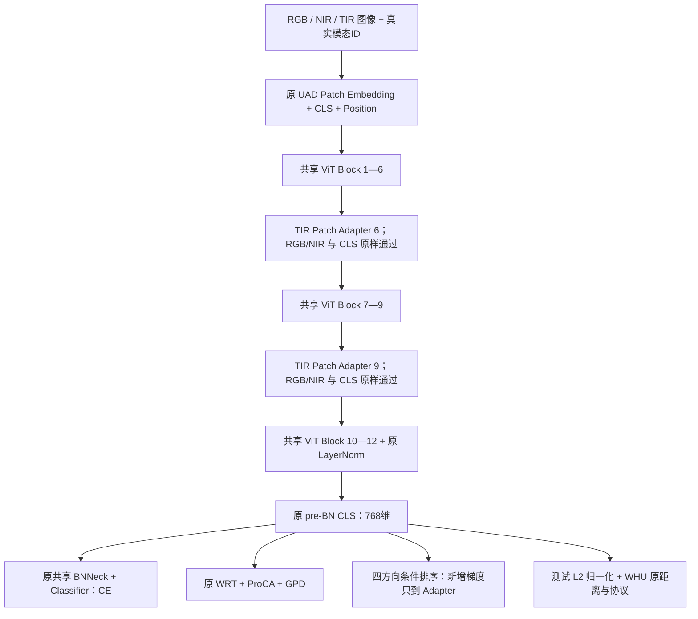

# UAD + TAUR-v1 实现与自检说明

日期：2026-10-12，已按运行日志完成 v2 修正，详见 `TAUR_FIXES.md`。实验对象：WHU-MARS-1000。方案依据：根目录 `idea.md`。

## 1. 实现结论与边界

保留方案主体：共享 ViT-B/16，在第 6、9 个 Block 后加入仅处理 TIR Patch 的两个独立 Adapter；继续使用 CE/WRT/ProCA/GPD；新增四方向条件排序，只将新增梯度施加到 Adapter。新版 TAUR 对 WRT 启用稳定 masked softmax，旧 UAD 配置保留原数值分支。测试仍用一个归一化的 768 维 pre-BN CLS 向量，遵循现有 WHU 评测。

TAUR 是本次自主组合设计。WSL、MDReID、MOS、UPCL 提供设计依据，不应将 Adapter、有界残差、四方向排序或梯度路由写成这些论文中已有的模块。论文与代码核对见 `TAUR_PAPER_REVIEW.md`。

本地没有 WHU 数据集或 `.pth/.pt` 权重。已审阅用户提供的截止 Epoch 16 的服务器日志，但未执行真实训练或权重表现诊断，也没有产生可供评测的训练权重。根目录没有 Git 元数据，未创建 Git 分支。初版修改前源码备份位于根目录 `tmp/taur_original/`，本轮修正前备份位于 `tmp/taur_review_original/`；参考项目、原始论文和 `idea.md` 均未修改。

## 2. 最终模型结构



默认输入 `256×128`，Patch/stride 为 `16×16`，共有 128 个 Patch，加 CLS 为 129 个 Token。L6/L9 对应 Block 循环索引 5/8，并在执行完该 Block 后调用。最后三个共享 Block 让 Patch 的改动传递到 CLS。

每个 Adapter：

\[
U=W_{up}\,GELU(W_{down}\,LN(H)),\quad 768\to128\to768,
\]

\[
\Delta H=0.10\frac{\|H\|_F}{\|H\|_F+\|U\|_F+10^{-6}}U,\quad H'=H+\Delta H.
\]

`H` 只包含当前 TIR 样本的 Patch。两个范数均按图像独立计算，AMP 下使用 FP32，保留范数的导数。故理论上 `||ΔH||F ≤ 0.10 ||H||F`。CLS 不直接送入 Adapter。RGB/NIR 不执行 Adapter 运算。模块在训练与测试均由真实 `modality_ids` 控制，不依赖 `model.training`。

LayerNorm 含仿射参数，down/up 都含 bias；down 权重初始化标准差 0.02，up 权重标准差 0.001，bias 为零。每个模块 199,040 个参数，合计 **398,080**，约 1.52 MiB FP32 参数存储（不含梯度、优化器状态）。Adapter 在原 UAD/分类器初始化完成后注册，避免改动基线随机初始化顺序或被原 ViT 初始化覆盖。

## 3. 原损失与新增排序

损失组成和系数保持本地 `UAD.yml` 的设置，WRT 数值修正由 `MODEL.WRT_STABLE` 控制：

\[
L_U=L_{CE}+L_{WRT}+0.01L_{ProCA}+L_{GPD}.
\]

CE 使用原 BNNeck 特征及共享分类器；WRT、ProCA、GPD 与排序使用原 pre-BN CLS。未改原 ProCA 函数、GPD 温度 0.03、原型更新顺序或新中心动量 0.2。

对归一化特征，`s_ij = fhat_i^T fhat_j`。候选条件同时用于正样本与负样本：真实 camera ID 不同、原始图像 sample ID 不同、符合当前 Gallery 模态要求。同身份为正，其余身份为负。

| 方向 | Query | 正、负 Gallery | 固定系数 |
|---|---|---|---|
| T2T | TIR | TIR | 0.25 |
| T2ALL | TIR | RGB/NIR/TIR | 0.25 |
| R2T | RGB | TIR | 0.25 |
| N2T | NIR | TIR | 0.25 |

每个有效正图像分别计算：

\[
\ell_{ij}=\tau\log\left(1+\sum_{k\in N_i}
\exp\frac{s_{ik}-s_{ij}+\gamma}{\tau}\right),
\quad\gamma=0.03,\ \tau=0.07.
\]

先对一个 Query 的全部正图像平均，再对方向内有效 Query 平均，最后 `L_rank = 0.25 Σ_d L_d`。有效 Query 必须同时存在正、负样本。没有有效 Query 的方向为可反向传播的零，不重新分配方向权重。

实现用负样本 `logsumexp` 加逐正样本 `softplus`，与上式严格等价，避免显式指数溢出。没有 Top-K、按负身份压缩、负图像数归一化或最高相似正样本替代。相似度矩阵及排序计算明确关闭 autocast，仅 `.float()` 不能保证 AMP 下矩阵乘法仍为 FP32。

重复采样的同一原图用稳定路径映射取得相同 sample ID。不同模态路径取得不同 ID。元数据按 `torch.cat(imgs)` 的模态优先顺序拼接；PKM 元组中三个模态的 PID 一致性会显式检查，最终完整 PID 为 `target.repeat(3)`。

## 4. 梯度更新与单卡/DDP

共享参数为 `θ`，Adapter 参数为 `φ`：

\[
g_\theta=\nabla_\theta L_U,\qquad
g_\phi=\nabla_\phi L_U+\lambda(e)\nabla_\phi L_{rank}.
\]

不是对 `L_U + λL_rank` 执行普通全模型 backward。共享主干继续由 UAD 更新；排序通过后续 Transformer 的真实计算图求 Adapter 导数，不将共享主干放入 no_grad，也不 detach TIR 最终特征。

权重日程：Epoch 1—5 为 0；6—20 为 `0.10×(e−5)/15`；之后为 0.10。Adapter 从 Epoch 1 起始终参与 UAD 前向和训练。

单卡步骤：一次前向；对 `scaler.scale(λ L_rank)` 求 Adapter 梯度并保留图；对 `scaler.scale(L_U)` 正常 backward；合并两个 scaled 梯度；统一 unscale、原 max_norm=1.0 裁剪、优化器 step、scaler update。权重为零时不做新增求导。

DDP 权重为零时使用原自动归约。非零时，`no_sync()` 包住同一次前向、单独求导和 UAD backward，合并后显式对所有实际使用的参数梯度平均归约。这是为实现方案的特殊梯度路由而增加的同步路径：DDP 自动 reducer 不直接支持 `autograd.grad`。不能自动归约 UAD 梯度后，又对已合并梯度归约一次。

归约按 device/dtype 分组，以约 16 MiB 的合并缓冲区执行，避免逐参数通信。先 MAX 归约各参数的使用标记；仅某卡使用的参数在其他卡补零；全局未使用的原 `base.fc` 保持 `grad=None`，不意外触发权重衰减。同步在 AMP unscale 前完成，使各卡得到相同的 Inf/NaN 并做一致的跳步决定。持续 no_sync 可能跳过 DDP 自动 buffer 广播，因此此路径每步显式广播 rank-0 模型 buffer，保留原 BN 运行统计语义。

GPD 仍使用原跨卡中心聚合与动量更新，未新增跨卡身份记忆。排序候选**仅为本卡图像**，DDP 对每卡条件目标的梯度平均。它不等于全局 Gallery 排序，也不等于按全局有效 Query 数重新加权。本轮不引入跨卡特征集合；以各卡有效 Query、正负图像数、相机数诊断候选是否充分。

## 5. 学习率、采样与预算的补充修正

原优化器、偏置倍率、weight decay、warm-up 和 cosine 设置保持不变。所有 Adapter 参数（包括 bias）以原 base schedule 的 3 倍运行，避免偏置倍率叠加成 6 倍。TAUR 调度器只覆盖 Adapter 分组，原分组的数值日程不变，warm-up 与 cosine 末端也保持 3 倍。

相机优先是独立开关 `DATALOADER.CAMERA_PRIORITY`，默认 False，TAUR 配置设为 True。旧 `sampler.py` 和 `sampler_ddp.py` 未修改。新采样器消费本轮图像池，先从池中尚有图像的不同真实相机各选一张，再补足 K；仅不足模态按原 PKM 的完整池重复/随机余量原则补样，尽量避免组内重复。只有一个相机的身份维持随机采样，不伪造相机，不强造 T2T 正样本。

新采样器保留原按模态最大图像数决定身份组数的预算尺度。只有必须立即安排才能完成预算的身份被强制选择，其余随机选择，并打乱完整批次。每个 global batch 包含互异身份，按整 K 组分给各 rank，每卡具有完整同身份三模态 K 组。`__len__` 与实际产出数量相等，不 padding，各卡步数一致。随机数由独立 `Random(seed+epoch)` 控制，各卡构造相同全局计划；每个 Epoch 调用 set_epoch。

图像充足时本轮不跨组重复；稀缺相机耗尽后使用剩余图像，不为制造正样本而重复少数相机图像，T2T 有效 Query 可能减少。尾部截断与身份预算上限仍可能改变覆盖和步数，应记录实际更新数。完整 TAUR 的公平对照为 `UAD_TAUR_control.yml`：相同修正采样、相同稳定 WRT，但关闭 TAUR。不能只用 120 Epoch 认定预算相等。

WHU 论文第 5.1 节写的是每卡 `P=16,M=3,K=4`，即每卡 192 张。而本地 `IMS_PER_BATCH` 是**全局三模态索引元组数**：

| 启动方式 | IMS_PER_BATCH | 每卡身份 P | 每卡实际图像 |
|---|---:|---:|---:|
| 单卡 | 64 | 16 | 192 |
| 四卡，保持本地 README 设置 | 256 | 16 | 192 |
| 四卡，直接保留 YAML 的 64 | 64 | 4 | 48 |

没有自动改动此语义或按 world size 偷改学习率。下面四卡命令沿用本地 README 的 `BASE_LR=0.032`；这是本地基线设置，不应称为直接等同论文写的每卡 0.008。TAUR 对照必须使用同样设置。

日志明确区分 UAD Loss、Rank Loss、weighted Rank、λ、裁剪前范数、AMP scale 和成功更新/跳步。每 Epoch 汇总各 rank 的有效 Query、关系数和相机数，并记录全局唯一图像覆盖。开启 `TAUR.LOG_DIRECTION_GRADS True` 时，诊断先缩放求导再除回尺度，记录本卡方向范数、DDP 平均向量范数，以及排序相对 UAD 的 Adapter 梯度贡献比与余弦；不修改训练梯度。损失系数 0.25 不代表相等实际梯度贡献。

## 6. 文件变更清单

从原始工程累计修改 10 个原文件，新增 13 个文件，无删除文件。本轮修正的清单见 `TAUR_FIXES.md`。临时论文提取/图片、修改前源码备份及检查产物位于根目录 `tmp/`，不属于模型功能。

| 修改文件 | 新增或修改功能及目的 |
|---|---|
| `config/defaults.py` | TAUR 全部默认关闭的配置、相机优先开关；旧配置可继续读取 |
| `model/backbones/vit_pytorch.py` | 注册独立 Adapter、检查真实模态标签、L6/L9 后按 TIR 路由 |
| `model/make_model.py` | 传递 modality_ids、注册模块、约束 pre-BN 推理、检查测试权重的 Adapter 配置一致性 |
| `datasets/bases.py` | 可选返回真实模态和稳定原图 ID；保留旧 3 元组接口 |
| `datasets/make_dataloader.py` | TAUR 元数据 collate、可选新 sampler、单卡与 DDP 共用路由 |
| `solver/make_optimizer.py` | Adapter 参数组及 3 倍 LR；避免 bias 叠加倍率 |
| `solver/scheduler_factory.py` | TAUR 专用子类维持全程 Adapter 3 倍 schedule；旧配置仍用原类 |
| `processor/processor.py` | 排序与梯度合并、特殊 DDP 同步、各 rank 诊断；验证/测试真实 modid 传给模型 |
| `loss/wrt_loss.py` | 可选稳定 masked softmax，保留 legacy 分支 |
| `loss/make_loss.py` | 接入 WRT_STABLE 开关，CPU 时不创建 CUDA center criterion |

| 新增文件 | 功能及目的 |
|---|---|
| `model/backbones/thermal_adapter.py` | 有界 TIR Patch 残差实现 |
| `loss/taur_rank_loss.py` | 四方向稳定全负图像排序、关系统计、λ 日程 |
| `processor/taur_grad.py` | scaled Adapter 导数、合并及按使用标记的显式同步 |
| `datasets/sampler_camera.py` | 单卡/DDP 可复现、真实相机优先、整 K 分片、准确长度的 PKM |
| `configs/TAUR.yml` | 独立实验配置，基于原 UAD 参数启用 TAUR 和相机优先 |
| `tests/test_taur.py` | 12 项无需训练数据的行为检查 |
| `tests/check_taur_ddp.py` | 两进程 Gloo 梯度/参数同步及采样检查脚本 |
| `docs/TAUR_IMPLEMENTATION.md` | 本说明：结构、损失、修正、运行、检查范围 |
| `docs/TAUR_PAPER_REVIEW.md` | 参考论文与本地实现核对、采用边界及不一致说明 |
| `configs/UAD_TAUR_control.yml` | 相同采样和稳定 WRT 的 UAD 对照 |
| `tests/amp_compat.py` | 旧 Torch 的 CPU 缩放自检兼容工具 |
| `tests/test_taur_fixes.py` | 日志修正的回归和真实训练/验证/推理入口检查 |
| `docs/TAUR_FIXES.md` | 本轮修正说明与新实验命令 |

原 `configs/UAD.yml`、`train.py`、`test.py`、原 CE 定义、原数据划分与 camera 编码、`utils/metrics.py`、原 sampler 均未改。关闭 TAUR，并保持 CAMERA_PRIORITY=False、WRT_STABLE=False，即走原 UAD 数值路径。

测试 checkpoint 必须使用匹配的 TAUR 开关、层位和瓶颈维度。缺少 Adapter 的 UAD checkpoint 不能直接当作 TAUR 测试模型静默接受。已有 `load_param_finetune` 可在代码中用于 UAD 权重初始化；本轮默认仍采用原 ImageNet 权重初始化后训练 120 Epoch。原工程没有完整断点续训入口，本轮未宣称提供恢复 optimizer/scheduler/GPD memory 的续训能力。

## 7. 启动与消融

以下命令在 `WHU/` 内运行；按服务器实际路径替换 ROOT_DIR/PRETRAIN_PATH。

```bash
# 单卡 TAUR，与本地单卡 UAD 保持相同训练预算参数
CUDA_VISIBLE_DEVICES=0 python train.py --config_file configs/TAUR.yml \
  DATASETS.ROOT_DIR /path/to/data MODEL.PRETRAIN_PATH /path/to/vit.pth \
  SOLVER.IMS_PER_BATCH 64 SOLVER.BASE_LR 0.008 \
  TAUR.LOG_DIRECTION_GRADS True OUTPUT_DIR logs/TAUR_1000_single_v2

# 四卡：每卡 16 身份 / 192 张，沿用本地 README 的 LR
CUDA_VISIBLE_DEVICES=0,1,2,3 torchrun --standalone --nproc_per_node=4 \
  train.py --config_file configs/TAUR.yml MODEL.DIST_TRAIN True \
  DATASETS.ROOT_DIR /path/to/data MODEL.PRETRAIN_PATH /path/to/vit.pth \
  SOLVER.IMS_PER_BATCH 256 SOLVER.BASE_LR 0.032 \
  TAUR.LOG_DIRECTION_GRADS True OUTPUT_DIR logs/TAUR_1000_DDP_v2

# 测试，包括原有 36 个模态/平台协议明细
CUDA_VISIBLE_DEVICES=0 python test.py --config_file configs/TAUR.yml \
  MODEL.DIST_TRAIN False MODEL.PRETRAIN_CHOICE none DATASETS.ROOT_DIR /path/to/data \
  TEST.WEIGHT logs/TAUR_1000_DDP_v2/transformer_120.pth \
  TEST.DETAILED_DOMAIN_EVAL True OUTPUT_DIR logs/TAUR_1000_DDP_v2_eval

# 自检
python -m pytest -q tests
python tests/check_taur_ddp.py
```

建议固定相同 seed、batch、LR、数据路径、训练步数口径和评测协议，依次比较：

| 实验 | 配置 | 额外覆盖项 |
|---|---|---|
| 原 UAD | `UAD.yml` | 无 |
| UAD + 相同相机采样/稳定 WRT | `UAD_TAUR_control.yml` | 无 |
| UAD + Adapter + 相同相机采样 | `TAUR.yml` | `TAUR.RANK_WEIGHT 0.0` |
| 完整 TAUR | `TAUR.yml` | 默认 |

实际是否改善不能由代码保证。至少观察整体 AS-ReID、TIR→TIR、TIR→混合 Gallery、RGB→TIR、NIR→TIR 的 mAP/Rank-1，以及 RGB/NIR 是否退化。现有域协议 CSV 保留，可用于模态与平台细分。T2ALL 与 T2T 关系重叠是方案有意强调；排序是 AP 代理，不能写成精确 mAP 优化。

## 8. 本地检查证据与未验证项

环境实际可用 Python 3.9.13、PyTorch 2.8.0+cpu、torchvision、timm、yacs、pytest。训练依赖文件未修改，其固定 Torch 版本为 2.2.2；CPU 自检工具已提供旧 Torch 缺少 native CPU GradScaler 时的测试兼容回退，训练继续使用原 CUDA AMP API。未实际安装执行完整 Torch 2.2.2 环境。

已完成：

- `python -m compileall -q WHU` 通过；model/datasets/processor 导入通过。
- `python -m pytest -q WHU/tests`：**31 passed**。弃用提示来自现有 torchvision/Pillow 及为兼容 Torch 2.2 保留的 CUDA AMP API。
- 独立加载修改前备份源码，与关闭 TAUR 的新 backbone/outer model 比较：同种子 state_dict 键、参数值、训练 3 项输出、推理输出均逐元素完全相同。
- 真实 ViT-B/16、`256×128`、129 Token、768 维输出检查通过；Adapter 参数 398,080；评估状态下 TIR 三模态组前向与单模态测试前向一致。
- 逐图像排序朴素公式与向量化公式的值和梯度一致；严格相机/重复图像过滤、反向 Gallery 范围、全负图像计数、空方向固定系数通过。
- Adapter 只改 TIR Patch，CLS/RGB/NIR 原样通过、范数界限、逐样本独立性、小非零初始化梯度、L6/L9 调用位置通过。
- 共享梯度等于纯 UAD 梯度；Adapter 梯度等于两项之和；新增误差信号能穿过后续共享 Block。
- 新 sampler 的准确长度、不同 Epoch、可复现 seed、四 rank 同全局计划、整 K 身份组、实际图像覆盖、不足模态平衡补样和稀缺相机不循环抽样通过（本地模拟分片）。
- 使用模拟 collective 验证显式归约的平均值、单卡使用参数补零、全局未用参数保留 None 和 Inf 传播。
- 0/1/4/5/20/119/120 Epoch 的 Adapter 与原 base LR 恒定 3 倍通过。
- TAUR checkpoint 前缀加载、UAD/TAUR 错配拒绝、ProCA/GPD 合成数据前向、反向及原型更新通过。
- 完整 768 维模型的合成训练步骤通过：CE + WRT + 0.01ProCA + GPD、四方向 TAUR、CPU AMP scaled 梯度合并、unscale、裁剪、SGD 更新和 GPD memory 更新；所有梯度有限、四方向均有效、Adapter 实际改变、原 base.fc 梯度仍为 None。此检查使用缩小空间尺寸的合成图像，不代表真实训练收敛。
- 新增真实 `do_train` 入口 CPU 合成 6 Epoch 检查，覆盖 λ 切换、方向诊断、全部 UAD 损失、优化器/调度器、验证及 `do_inference`，通过。

尚未通过或无法执行：

- **真实两进程 DDP 未通过验证**：本机 Gloo 在初始化时报 `makeDeviceForHostname(): unsupported gloo device`；回环接口和 `GLOO_DEVICE_TRANSPORT=UV` 也报 unsupported device。失败发生在模型/损失计算前，不能据此认定新增梯度归约已通过真实 DDP。检查脚本保留用于 Linux 服务器。
- 无 CUDA/NCCL，未验证 GPU FP16 overflow、实际四卡训练、通信性能或显存开销。
- 无真实数据和训练权重，未验证训练收敛、最优超参数、mAP/Rank-1、日志与论文成绩复现。

在服务器上先运行检查脚本，再进行短程训练，确认各 rank 四方向有效 Query 非长期为零、梯度有限、参数一致，然后运行完整训练。这里是尚未执行的验证项，不是已完成的性能结论。
